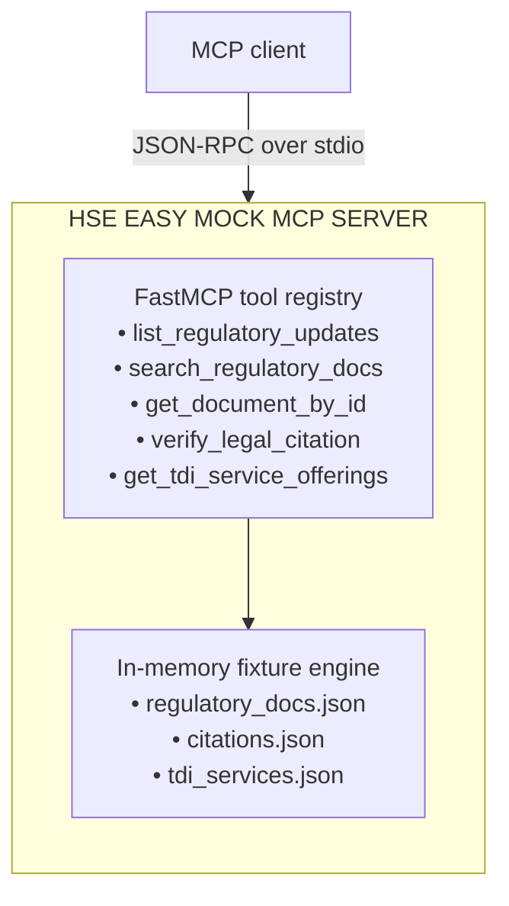

# HSE Easy Mock MCP Server — Architecture

| Field | Value |
| --- | --- |
| Document version | 1.0.0 |
| Project | HSE Easy Mock MCP Server |
| Audience | Solution architects and software engineers |
| Scope | Mock MCP server components, lifecycle, data fixtures, and MCP tool contracts |

## 1. Purpose and architectural context

The HSE Easy Mock MCP Server is a local, deterministic data service. It exposes a stable [Model Context Protocol (MCP)](https://modelcontextprotocol.io/) interface over:

- external regulatory sources (EUR-Lex, Gazzetta Ufficiale, and INAIL); and
- internal commercial assets (the TDI service catalog).

The server is intentionally self-contained: it loads checked-in fixtures into memory, validates them against typed models, and serves requests over standard input/output (stdio). This document describes the mock server only; consumer workflows and deployment environments are outside its scope.

### 1.1. Mock server topology



## 2. Internal component architecture

The mock server has no runtime service dependencies, starts in under 50 ms, and produces deterministic results for tests.

### 2.1. Repository layout

```text
hse-easy-mock-mcp/
├── pyproject.toml              # fastmcp and pydantic dependencies
├── server.py                   # server instance, tools, and query logic
├── models.py                   # typed Pydantic data contracts
├── fixtures/                   # deterministic seed data
│   ├── regulatory_docs.json    # regulatory acts and metadata
│   ├── citations.json          # legal citations and canonical URLs
│   └── tdi_services.json       # TDI catalog and CTA templates
└── README.md                   # integration and client configuration
```

### 2.2. Startup and indexing lifecycle

1. **Instantiate:** FastMCP creates an MCP server over standard input/output (stdio).
2. **Load fixtures:** `server.py` reads JSON files and validates them with Pydantic models.
3. **Build indexes:** In-memory dictionaries and lookup tables are created for documents, citations, and services.
4. **Publish tools:** FastMCP derives JSON Schema from function signatures and exposes the tools through `tools/list`.

The lifecycle is intentionally deterministic so that every client receives repeatable results from the same fixture set.

## 3. MCP tool contracts

| Tool | Purpose | Determinism requirement |
| --- | --- | --- |
| `list_regulatory_updates` | List updates with source/date filters | Stable ordering by publication date |
| `search_regulatory_docs` | Search by keywords, source, or topic | Reproducible matching and result shape |
| `get_document_by_id` | Retrieve a complete document | Exact identifier lookup |
| `verify_legal_citation` | Validate citation and legal status | Canonical citation and status result |
| `get_tdi_service_offerings` | Return relevant TDI services and CTAs | Taxonomy match with a defined fallback |

## 4. Blueprint implementation

### 4.1. `models.py`

```python
from typing import List, Literal, Optional

from pydantic import BaseModel


class RegulatoryUpdateSummary(BaseModel):
    doc_id: str
    source: Literal["EUR_LEX", "GAZZETTA_UFFICIALE", "INAIL"]
    doc_type: Literal["directive", "regulation", "decree", "circular", "guideline"]
    official_reference: str
    title: str
    publication_date: str
    effective_date: Optional[str] = None
    impact_level: Literal["critical", "high", "medium", "low"]
    topic_tags: List[str]
    summary: str
    canonical_url: str


class RegulatoryDocument(RegulatoryUpdateSummary):
    status: Literal["in_force", "amended", "repealed", "proposed"]
    target_sectors: List[str]
    key_obligations: List[str]
    penalties_summary: Optional[str] = None
    related_citations: List[str]
    content_markdown: str


class CitationVerificationResult(BaseModel):
    citation_input: str
    is_valid: bool
    status: Literal["in_force", "amended", "repealed", "unrecognized"]
    canonical_citation: str
    official_reference: Optional[str] = None
    official_url: Optional[str] = None
    verified_against_doc_id: Optional[str] = None
    notes: Optional[str] = None


class TDIServiceOffering(BaseModel):
    service_id: str
    service_name: str
    topic_category: str
    applicable_sectors: List[str]
    value_proposition: str
    cta_headline: str
    cta_body: str
    landing_page_url: str
```

### 4.2. `server.py`

```python
import json
from operator import attrgetter
from pathlib import Path
from typing import List, Literal, Optional

from fastmcp import FastMCP

from models import (
    CitationVerificationResult,
    RegulatoryDocument,
    RegulatoryUpdateSummary,
    TDIServiceOffering,
)


mcp = FastMCP("HSE-Easy-Mock-Server")
FIXTURES_DIR = Path(__file__).parent / "fixtures"

with open(FIXTURES_DIR / "regulatory_docs.json", encoding="utf-8") as f:
    REGULATORY_DOCS = [RegulatoryDocument(**d) for d in json.load(f)]
with open(FIXTURES_DIR / "citations.json", encoding="utf-8") as f:
    CITATIONS_RAW = json.load(f)
with open(FIXTURES_DIR / "tdi_services.json", encoding="utf-8") as f:
    TDI_SERVICES = [TDIServiceOffering(**s) for s in json.load(f)]


SUMMARY_EXCLUDE = {
    "status", "target_sectors", "key_obligations", "penalties_summary",
    "related_citations", "content_markdown",
}


def to_summary(doc: RegulatoryDocument) -> RegulatoryUpdateSummary:
    return RegulatoryUpdateSummary(**doc.model_dump(exclude=SUMMARY_EXCLUDE))


@mcp.tool()
def list_regulatory_updates(
    source: Optional[Literal["EUR_LEX", "GAZZETTA_UFFICIALE", "INAIL"]] = None,
    date_from: Optional[str] = None,
    date_to: Optional[str] = None,
    limit: int = 10,
) -> List[RegulatoryUpdateSummary]:
    """List recent HSE regulatory updates across sources."""
    results = REGULATORY_DOCS
    if source:
        results = [d for d in results if d.source == source]
    if date_from:
        results = [d for d in results if d.publication_date >= date_from]
    if date_to:
        results = [d for d in results if d.publication_date <= date_to]
    return [to_summary(d) for d in sorted(
        results, key=attrgetter("publication_date"), reverse=True
    )[:limit]]


@mcp.tool()
def search_regulatory_docs(
    query: str,
    source: Optional[Literal["EUR_LEX", "GAZZETTA_UFFICIALE", "INAIL"]] = None,
    topic: Optional[str] = None,
) -> List[RegulatoryUpdateSummary]:
    """Search the regulatory database by keyword, topic, or authority."""
    q = query.lower()
    matches = []
    for doc in REGULATORY_DOCS:
        if source and doc.source != source:
            continue
        if topic and topic.lower() not in [t.lower() for t in doc.topic_tags]:
            continue
        if (q in doc.title.lower() or q in doc.summary.lower()
                or q in doc.official_reference.lower()
                or any(q in t.lower() for t in doc.topic_tags)):
            matches.append(doc)
    return [to_summary(d) for d in matches]


@mcp.tool()
def get_document_by_id(doc_id: str) -> RegulatoryDocument:
    """Retrieve full text and compliance obligations by document ID."""
    for doc in REGULATORY_DOCS:
        if doc.doc_id == doc_id:
            return doc
    raise ValueError(f"Document with ID '{doc_id}' not found.")


@mcp.tool()
def verify_legal_citation(
    citation: str,
    source: Optional[Literal["EUR_LEX", "GAZZETTA_UFFICIALE", "INAIL"]] = None,
) -> CitationVerificationResult:
    """Verify legal citation validity, status, and canonical URL."""
    normalized = citation.strip().lower()
    for entry in CITATIONS_RAW:
        aliases = [a.lower() for a in entry.get("aliases", [])]
        aliases.append(entry["citation_input"].lower())
        if normalized in aliases:
            return CitationVerificationResult(**entry)
    return CitationVerificationResult(
        citation_input=citation,
        is_valid=False,
        status="unrecognized",
        canonical_citation=citation,
        notes="Citation not recognized in authoritative legal registry.",
    )


@mcp.tool()
def get_tdi_service_offerings(
    topic: str,
    sector: Optional[str] = None,
) -> List[TDIServiceOffering]:
    """Retrieve relevant TDI services and pre-approved calls to action."""
    value = topic.lower()
    matches = [
        service for service in TDI_SERVICES
        if value in service.topic_category.lower()
        or any(value in item.lower() for item in service.applicable_sectors)
    ]
    return matches or TDI_SERVICES[:1]


if __name__ == "__main__":
    mcp.run()
```
