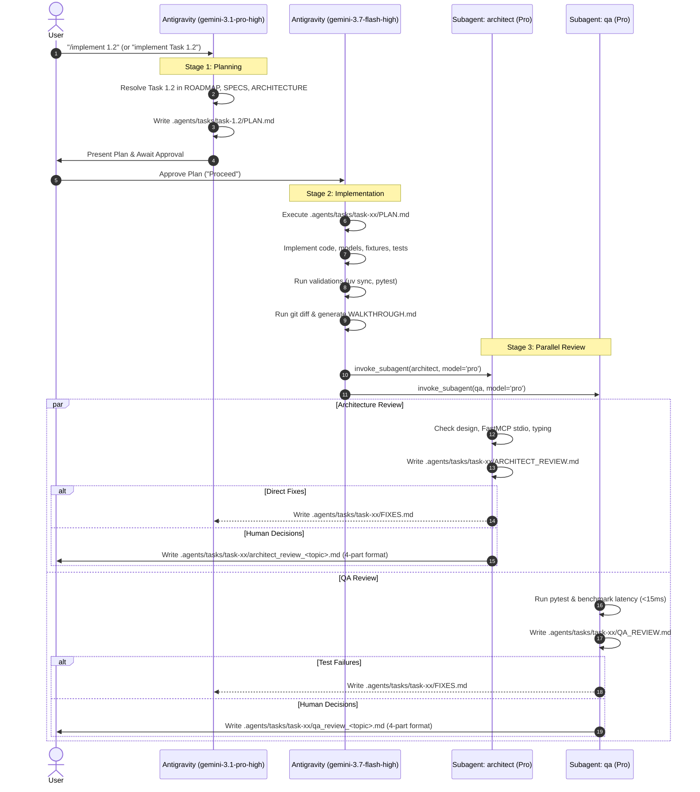

# Task Implementation Workflow Runbook

**Trigger**: Prompts matching `/implement <task_id>`, `/implement task <task_id>`, or `"implement Task x of Phase x"` (e.g. `/implement 1.2`, `/implement task 1.2`, `"implement Task 1.2 of Phase 1"`).

---

## Stage 1: Implementation Plan
1. Retrieve task specifications from [ROADMAP.md](file:///C:/Users/Saksham/Git/poc/AIAgents/mcp-server/ROADMAP.md), [SPECIFICATIONS.md](file:///C:/Users/Saksham/Git/poc/AIAgents/mcp-server/.agents/docs/SPECIFICATIONS.md), and [ARCHITECTURE.md](file:///C:/Users/Saksham/Git/poc/AIAgents/mcp-server/.agents/docs/ARCHITECTURE.md).
2. Model: `gemini-3.1-pro-high` (`pro` deep reasoning).
3. Required Sections in `PLAN.md`:
   - `## 1. Context & Task Scope`
   - `## 2. Prerequisites` (if any)
   - `## 3. Objectives`
   - `## 4. Proposed Changes & Specifications`
   - `## 5. Verification Strategy`
   - `## 6. Questions & Decisions for Human Approval` (if any design decisions or choices require human input; **MUST** follow the [Mandatory Question Convention](file:///C:/Users/Saksham/Git/poc/AIAgents/mcp-server/AGENTS.md#4-mandatory-question-convention))
4. Deliverable: Save structured plan as `.agents/tasks/task-<task_id>/PLAN.md`.
5. **Human Approval Gate**: Stop and wait for user approval (including resolution of any questions in Section 6) before moving to Stage 2.

---

## Stage 2: Autonomous Implementation (Upon Human Approval)
1. **Trigger**: Starts immediately after explicit human approval of Stage 1 plan.
2. **Model**: `gemini-3.7-flash-high` (`flash` execution).
3. **Permissions & Autonomy**:
   - **Full Execution Permission**: Pre-authorized for all file reads, creations, edits, deletions, directory operations, and terminal commands (`uv`, `pytest`, `python`, `git diff`, benchmarks, etc.) within the workspace.
4. **Execution Steps**:
   - Write and edit code according to `.agents/tasks/task-<task_id>/PLAN.md`.
   - Validate locally (e.g. `uv sync`, `pytest`, `python -m py_compile`).
   - Run `git diff` via terminal to inspect actual repository modifications, and generate `WALKTHROUGH.md` strictly using the `git diff` output (not from implementation memory), explaining exact modifications, architecture, and verification results without embedding the raw `git diff` patch block.
   - Automatically transition directly to Stage 3 (Parallel Review) upon walkthrough completion without stopping.
5. **Deliverable**: Save summary as `.agents/tasks/task-<task_id>/WALKTHROUGH.md`.

---

## Stage 3: Parallel Review & Iterative Fix Loop (Max 3 Iterations)
1. **Parallel Execution**: Invoke subagents `architect` and `qa` concurrently using `invoke_subagent` with `Model: 'pro'`.
2. **Reviewer Permissions**:
   - **Workspace-wide (Non-Edit)**: Pre-approved for all read, search, listing, and test/benchmark command executions. Code editing outside `.agents/tasks/` is strictly prohibited.
   - **Task Directory (`.agents/tasks/`)**: Full create, write, and edit permissions within `.agents/tasks/` for reviews, logs, and question files.
3. **Review Deliverables**:
   - `architect` generates `.agents/tasks/task-<task_id>/ARCHITECT_REVIEW.md`.
   - `qa` generates `.agents/tasks/task-<task_id>/QA_REVIEW.md`.
4. **Consolidated Feedback**: Subagents record actionable fixes in `.agents/tasks/task-<task_id>/FIXES.md`.
5. **Unified Fix & Re-Invocation**:
   - Once both passes complete, the main agent applies all fixes in one unified pass.
   - The main agent cleans up `FIXES.md` and re-invokes `architect` and `qa` for verification until full sign-off.
   - A maximum of **3 review iterations** is allowed.
6. **Human Decisions**: If trade-offs remain after 3 iterations, generate a review file under `.agents/tasks/task-<task_id>/` adhering to the [Mandatory Question Convention](file:///C:/Users/Saksham/Git/poc/AIAgents/mcp-server/AGENTS.md#4-mandatory-question-convention).
7. Detailed runbook: [`.agents/workflows/review_cycle.md`](file:///C:/Users/Saksham/Git/poc/AIAgents/mcp-server/.agents/workflows/review_cycle.md).

