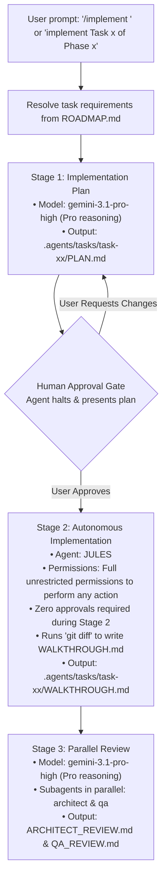

# Automated Task Implementation Workflow

This document details the standardized 3-stage automated implementation workflow for roadmap tasks within the **HSE Easy Mock MCP Server** project.

---

## Workflow Overview

---

## Stage Breakdown

### 1. Stage 1: Implementation Plan
* **Agent / Model**: Antigravity with `gemini-3.1-pro-high` (`pro` deep reasoning).
* **Action**:
  1. Retrieve task details from [`ROADMAP.md`](file:///C:/Users/Saksham/Git/poc/AIAgents/mcp-server/ROADMAP.md), [`SPECIFICATIONS.md`](file:///C:/Users/Saksham/Git/poc/AIAgents/mcp-server/.agents/docs/SPECIFICATIONS.md), and [`ARCHITECTURE.md`](file:///C:/Users/Saksham/Git/poc/AIAgents/mcp-server/.agents/docs/ARCHITECTURE.md).
  2. Formulate a structured plan with the following **mandatory sections**:
     - `## 1. Context & Task Scope`
     - `## 2. Prerequisites` (if any, e.g. previous tasks or runtime tools)
     - `## 3. Objectives`
     - `## 4. Proposed Changes & Specifications` (including exact file paths, schemas, and logic)
     - `## 5. Verification Strategy` (test commands, deterministic assertions)
     - `## 6. Questions & Decisions for Human Approval` (if any design decisions, ambiguities, or choices require human input; **MUST** follow the [Mandatory Question Convention](file:///C:/Users/Saksham/Git/poc/AIAgents/mcp-server/AGENTS.md#4-mandatory-question-convention))
* **Deliverable**: Save the plan as `.agents/tasks/task-<task_id>/PLAN.md`.
* **Human Approval Requirement**: Stop and ask user for approval before writing code or running Stage 2.

### 2. Stage 2: Autonomous Implementation (Upon Human Approval)
* **Trigger**: Starts **only after explicit human approval** of the Stage 1 plan.
* **Agent**: **Jules** (Google AI coding agent, invoked via Google AI's `jules` CLI / [`jules`](file:///C:/Users/Saksham/Git/poc/AIAgents/mcp-server/.agents/agents/jules.md)).
* **Permissions & Autonomy**:
  * **All Permissions / Unrestricted Autonomous Action**: Jules is granted full, unrestricted permissions to perform any action required across the workspace (file operations, package management, test execution, benchmarks, git operations, CLI session creation and pulling patches via `jules`, arbitrary terminal commands). Zero interactive human approvals required during Stage 2.
* **Action**:
  1. Trigger Google AI's Jules agent (via `jules new "<prompt>"` or direct CLI session) with the approved `.agents/tasks/task-<task_id>/PLAN.md` instructions. Jules implements the code changes autonomously.
  2. Run automated validation commands (e.g. `uv sync`, `pytest`, syntax and type checks).
  3. **Diff-driven Walkthrough**: Run `git diff` via terminal to inspect actual workspace modifications. The walkthrough **MUST be generated strictly from the actual `git diff` output** (not from implementation memory), explaining the exact changes, structure, rationale, and verification results without embedding the raw `git diff` patch block.
  4. Automatically proceed directly to Stage 3 (Parallel Review) without pausing for human input.
* **Deliverable**: Save `.agents/tasks/task-<task_id>/WALKTHROUGH.md`.

### 3. Stage 3: Parallel Review & Iterative Fix Loop (Max 3 Iterations)
* **Subagents**: Invoke both `architect` and `qa` in parallel using `invoke_subagent` with `Model: 'pro'` (`gemini-3.1-pro-high`).
* **Permissions & Autonomy**:
  * **Workspace-wide (Non-Edit)**: Pre-approved for non-edit operations across the entire workspace (viewing files, reading docs/code, searching via grep, listing directories, read-only test runner execution `pytest`, and benchmark latency profiling).
  * **Task Directory (`.agents/tasks/`)**: Full create, write, and edit permissions within `.agents/tasks/` (`ARCHITECT_REVIEW.md`, `QA_REVIEW.md`, `FIXES.md`, and review files).
* **Consolidated Feedback & Iterative Fix Loop**:
  1. In each review pass, `architect` and `qa` record their findings in `ARCHITECT_REVIEW.md` and `QA_REVIEW.md` and write any actionable fixes to `FIXES.md`.
  2. Once both subagents complete their review pass:
     - If both approve with no fixes requested: Complete review cycle with full sign-off.
     - If fixes are requested: JULES reads `.agents/tasks/task-<task_id>/FIXES.md` (and review files), applies all requested fixes in a unified pass, cleans up `FIXES.md`, and re-invokes `architect` and `qa` for the next review iteration.
  3. **Loop Boundary**: A maximum of **3 review iterations** is allowed.
  4. If unresolved issues or trade-offs remain after 3 iterations: Create a human review file adhering to the [Mandatory Question Convention](file:///C:/Users/Saksham/Git/poc/AIAgents/mcp-server/AGENTS.md#4-mandatory-question-convention).
