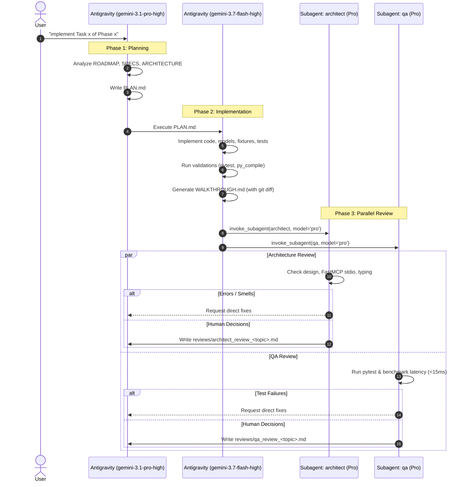

# Task Implementation Workflow Runbook

**Trigger**: Prompts matching `"implement Task x of Phase x"` (e.g. `"implement Task 1.1 of Phase 1"`).

---

## Phase 1: Implementation Plan
1. Retrieve task specifications from [ROADMAP.md](file:///C:/Users/Saksham/Git/poc/AIAgents/mcp-server/ROADMAP.md), [SPECIFICATIONS.md](file:///C:/Users/Saksham/Git/poc/AIAgents/mcp-server/.agents/docs/SPECIFICATIONS.md), and [ARCHITECTURE.md](file:///C:/Users/Saksham/Git/poc/AIAgents/mcp-server/.agents/docs/ARCHITECTURE.md).
2. Model: `gemini-3.1-pro-high` (`pro` deep reasoning).
3. Deliverable: Save structured plan as [PLAN.md](file:///C:/Users/Saksham/Git/poc/AIAgents/mcp-server/PLAN.md) at the project root.

---

## Phase 2: Implementation
1. Execute file writes, edits, and terminal commands across the project directory.
2. Model: `gemini-3.7-flash-high` (`flash` execution).
3. Validate locally (e.g. `pytest`, `python -m py_compile`).
4. Deliverable: Save structured summary as [WALKTHROUGH.md](file:///C:/Users/Saksham/Git/poc/AIAgents/mcp-server/WALKTHROUGH.md) embedding the `git diff` of modified files.

---

## Phase 3: Parallel Review & Iterative Fix Loop (Max 3 Iterations)
1. **Parallel Execution**: Invoke subagents `architect` and `qa` concurrently using `invoke_subagent` with `Model: 'pro'`.
2. **Consolidated Feedback**: Both subagents append their findings to [`reviews/FIXES.md`](file:///C:/Users/Saksham/Git/poc/AIAgents/mcp-server/reviews/FIXES.md).
3. **Unified Fix & Re-Invocation**:
   - Once both passes complete, the main agent applies all fixes from `reviews/FIXES.md` in one pass.
   - The main agent cleans up `reviews/FIXES.md` and re-invokes `architect` and `qa` for verification.
   - A maximum of **3 review iterations** is allowed.
4. **Human Decisions**: If trade-offs remain after 3 iterations, generate a review file under `reviews/` adhering to the [Mandatory Question Convention](file:///C:/Users/Saksham/Git/poc/AIAgents/mcp-server/AGENTS.md#4-mandatory-question-convention).
5. Detailed runbook: [`.agents/workflows/review_cycle.md`](file:///C:/Users/Saksham/Git/poc/AIAgents/mcp-server/.agents/workflows/review_cycle.md).
