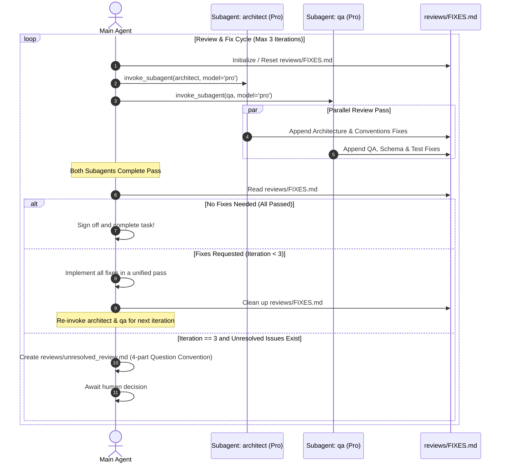

# Parallel Review Cycle Workflow Runbook

**Trigger**: Invoked automatically after Phase 2 (Implementation) completes.

---

## 1. Review Loop Architecture (Max 3 Iterations)



---

## 2. Temporary Feedback File Specification (`reviews/FIXES.md`)

In each review pass, `architect` and `qa` write their requested changes into [`reviews/FIXES.md`](file:///C:/Users/Saksham/Git/poc/AIAgents/mcp-server/reviews/FIXES.md) using this structure:

```markdown
# Review Feedback & Required Fixes (Iteration X/3)

---

## 🏛️ Architecture & Code Conventions (`architect`)
* **Status**: Passed / Fixes Required
* **Items**:
  1. `models.py` (Lines 45–52): Add missing Field constraints.
  2. `server.py` (Line 180): Refactor sorting to use `operator.attrgetter`.

---

## 🧪 Quality Assurance & Test Verification (`qa`)
* **Status**: Passed / Fixes Required
* **Items**:
  1. `tests/test_server.py`: Missing test case for repealed citation `D.Lgs. 626/94`.
  2. Latency benchmark: Optimize lookup table to satisfy <15ms response target.

---

## ❓ Items Requiring Human Approval
*(Formatted using the 4-part Question Convention if architectural/product decisions are needed)*
```

---

## 3. Review Subagent Execution Protocol

### `architect` Subagent
1. Audits component boundaries, FastMCP lifecycle, Pydantic v2 schemas, and code conventions.
2. Appends items to `## 🏛️ Architecture & Code Conventions` in `reviews/FIXES.md`.
3. Reports completion of review pass to main agent.

### `qa` Subagent
1. Executes `pytest` test suites, verifies acceptance criteria from [SPECIFICATIONS.md](file:///C:/Users/Saksham/Git/poc/AIAgents/mcp-server/.agents/docs/SPECIFICATIONS.md), and benchmarks latency (<15ms).
2. Appends items to `## 🧪 Quality Assurance & Test Verification` in `reviews/FIXES.md`.
3. Reports completion of review pass to main agent.

---

## 4. Main Agent Re-Invocation & Loop Boundary
1. **Consolidated Fix Implementation**: The main agent waits until **both** subagents finish their pass, then applies all items from `reviews/FIXES.md` in one unified pass.
2. **Re-Invocation**: After implementing the fixes, the main agent clears `reviews/FIXES.md` and re-invokes `architect` and `qa` (`invoke_subagent` with `Model: 'pro'`).
3. **Termination Conditions**:
   - **Success**: Both subagents mark their status as `Passed` with 0 items $\rightarrow$ Task completed.
   - **Max Iterations (3)**: If issues persist after 3 iterations $\rightarrow$ Escalate to human via review file with the [Mandatory Question Convention](file:///C:/Users/Saksham/Git/poc/AIAgents/mcp-server/AGENTS.md#4-mandatory-question-convention).
