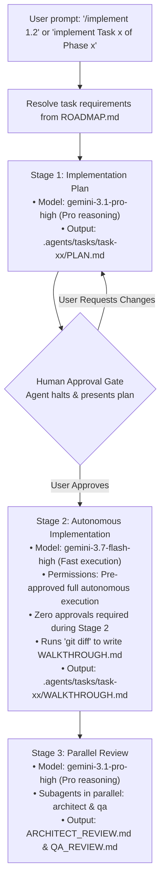

# Agent Instructions & Guidelines

Welcome, Agent. This repository contains the **HSE Easy Mock MCP Server** implementation and tooling. When assisting with tasks in this project, you are required to use the project documentation, specialized subagents, workspace skills, and the automated task execution workflow defined below.

---

## 1. Project Documentation (`.agents/docs/`)

Always read and align with the documentation before proposing plans, implementing features, or making architectural modifications:

* **[ARCHITECTURE.md](file:///C:/Users/Saksham/Git/poc/AIAgents/mcp-server/.agents/docs/ARCHITECTURE.md)**:
  * Outlines system topology, component boundaries, startup and in-memory fixture indexing lifecycle, and tool contracts.
  * Consult this whenever designing components, modifying server lifecycles, or changing data flow.
* **[SPECIFICATIONS.md](file:///C:/Users/Saksham/Git/poc/AIAgents/mcp-server/.agents/docs/SPECIFICATIONS.md)**:
  * Details product requirements, two-tier Pydantic v2 schemas (`RegulatoryUpdateSummary`, `RegulatoryDocument`, `LegalCitationVerification`, `TDIServiceCatalog`), tool signatures, input/output schemas, and deterministic fixture requirements.
  * Consult this whenever implementing or updating MCP tools, data models, or fixtures.
* **[ROADMAP.md](file:///C:/Users/Saksham/Git/poc/AIAgents/mcp-server/ROADMAP.md)**:
  * Contains the phased milestones, task breakdown, and acceptance criteria checklist.

---

## 2. Workspace Skills (`.agents/skills/`)

Leverage the specialized workspace skills below for their respective task domains:

| Skill | Path | Accessible By | When to Use |
| :--- | :--- | :--- | :--- |
| **`implement`** | [`.agents/skills/implement/SKILL.md`](file:///C:/Users/Saksham/Git/poc/AIAgents/mcp-server/.agents/skills/implement/SKILL.md) | Main Agent | **Automated roadmap task implementation workflow.** Invoked via `/implement <task_id>` (e.g. `/implement 1.2`), `/implement task <task_id>`, or task implementation prompts. |
| **`mcp-builder`** | [`.agents/skills/mcp-builder/SKILL.md`](file:///C:/Users/Saksham/Git/poc/AIAgents/mcp-server/.agents/skills/mcp-builder/SKILL.md) | Main Agent, `architect`, `qa` | **Creating, implementing, testing, or evaluating MCP servers & tools.** Provides best practices for FastMCP/TypeScript SDKs, stdio transports, tool schemas, annotations, and automated evaluation suites. |
| **`architect-review`** | [`.agents/skills/architect-review/SKILL.md`](file:///C:/Users/Saksham/Git/poc/AIAgents/mcp-server/.agents/skills/architect-review/SKILL.md) | Main Agent, `architect` | **System design and architectural reviews.** Provides guidance for evaluating structural changes, modular boundaries, scalability, resilience, clean architecture, and distributed patterns. |
| **`code-reviewer`** | [`.agents/skills/code-reviewer/SKILL.md`](file:///C:/Users/Saksham/Git/poc/AIAgents/mcp-server/.agents/skills/code-reviewer/SKILL.md) | Main Agent, `architect`, `qa` | **Code quality, static analysis, and security auditing.** Use when reviewing pull requests, inspecting diffs, checking OWASP security, enforcing type safety, and optimizing performance. |

---

## 3. Automated Task Execution Workflow

Whenever the user gives a prompt such as **`/implement <task_id>`** (e.g. `/implement 1.2`), **`/implement task <task_id>`** (e.g. `/implement task 1.2`), or **"implement Task x of Phase x"** (e.g., matching a task in [`ROADMAP.md`](file:///C:/Users/Saksham/Git/poc/AIAgents/mcp-server/ROADMAP.md)), the agent **MUST** automatically resolve the matching task from [`ROADMAP.md`](file:///C:/Users/Saksham/Git/poc/AIAgents/mcp-server/ROADMAP.md) and execute the following 3-stage workflow with an explicit human approval gate between Stage 1 and Stage 2.

All task artifacts (plan, walkthrough, fixes, reviews) **MUST** be stored in a dedicated folder: `.agents/tasks/task-<task_id>/` (e.g., `.agents/tasks/task-1.2/`).



### 3.1. Stage 1: Implementation Plan
* **Agent / Model**: Antigravity with `gemini-3.1-pro-high` (`pro` deep reasoning).
* **Action**:
  1. Retrieve task details from [`ROADMAP.md`](file:///C:/Users/Saksham/Git/poc/AIAgents/mcp-server/ROADMAP.md), [`SPECIFICATIONS.md`](file:///C:/Users/Saksham/Git/poc/AIAgents/mcp-server/.agents/docs/SPECIFICATIONS.md), and [`ARCHITECTURE.md`](file:///C:/Users/Saksham/Git/poc/AIAgents/mcp-server/.agents/docs/ARCHITECTURE.md).
  2. Formulate a structured plan with the following **mandatory sections**:
     - `## 1. Context & Task Scope`
     - `## 2. Prerequisites` (if any, e.g. previous tasks or runtime tools)
     - `## 3. Objectives`
     - `## 4. Proposed Changes & Specifications` (including exact file paths, schemas, and logic)
     - `## 5. Verification Strategy` (test commands, deterministic assertions)
     - `## 6. Questions & Decisions for Human Approval` (if any design decisions, ambiguities, or choices require human input; **MUST** follow the [Mandatory Question Convention](#4-mandatory-question-convention))
* **Deliverable**: Save the plan as `.agents/tasks/task-<task_id>/PLAN.md` (e.g., [`.agents/tasks/task-1.1/PLAN.md`](file:///C:/Users/Saksham/Git/poc/AIAgents/mcp-server/.agents/tasks/task-1.1/PLAN.md)).
* **Human Approval Requirement**: After generating `PLAN.md`, the agent **MUST stop and ask the user for approval** (including resolving any questions in Section 6) before writing code or running Stage 2.

### 3.2. Stage 2: Autonomous Implementation (Upon Human Approval)
* **Trigger**: Starts **only after explicit human approval** of the Stage 1 plan.
* **Agent / Model**: Antigravity with `gemini-3.7-flash-high` (`flash` high-speed execution).
* **Permissions & Autonomy**:
  * **Full Autonomous Execution**: Pre-approved for all file reads, creations, edits, deletions, and terminal command executions (e.g., `uv sync`, `pytest`, `python`, `git diff`, benchmarks).
* **Action**:
  1. Write and edit code according to `.agents/tasks/task-<task_id>/PLAN.md`.
  2. Run automated validation commands (e.g. `uv sync`, `pytest`, syntax compilation).
  3. **Diff-driven Walkthrough**: Run `git diff` via terminal to inspect actual workspace modifications. The walkthrough **MUST be generated strictly from the actual `git diff` output** (not from implementation memory), explaining the exact changes, structure, rationale, and verification results without embedding the raw `git diff` patch block.
  4. Automatically proceed directly to Stage 3 (Parallel Review) without pausing for human input.
* **Deliverable**: Save `.agents/tasks/task-<task_id>/WALKTHROUGH.md` detailing the changes made, rationale, and verification results.

### 3.3. Stage 3: Parallel Review & Iterative Fix Loop (Max 3 Iterations)
* **Subagents**: Invoke both `architect` and `qa` in parallel using `invoke_subagent` with `Model: 'pro'` (`gemini-3.1-pro-high`).
* **Subagent Permissions & Access Scope**:
  * **Workspace-wide (Non-Edit)**: Pre-approved for all non-edit operations across the entire workspace (viewing files, reading docs/code, searching via grep, directory listing, read-only test runner execution `pytest`, and benchmark latency profiling). Code editing outside `.agents/tasks/` is strictly prohibited for reviewer subagents.
  * **Task Directory (`.agents/tasks/`)**: Full create, write, and edit permissions within `.agents/tasks/` (to write and manage `ARCHITECT_REVIEW.md`, `QA_REVIEW.md`, `FIXES.md`, and any review files).
* **Subagent Roles & Deliverables**:
  * **`architect` Subagent**:
    * Skills: `architect-review`, `code-reviewer`, `mcp-builder`.
    * Checks: System boundaries, FastMCP lifecycle, Pydantic v2 schemas, clean architecture, and coding conventions.
    * **Deliverable**: Saves its detailed architectural evaluation as `.agents/tasks/task-<task_id>/ARCHITECT_REVIEW.md`.
  * **`qa` Subagent**:
    * Skills: `code-reviewer`, `mcp-builder`.
    * Checks: Acceptance criteria verification from [`SPECIFICATIONS.md`](file:///C:/Users/Saksham/Git/poc/AIAgents/mcp-server/.agents/docs/SPECIFICATIONS.md), test execution (`pytest`), fixture integrity, and response latency (<15ms).
    * **Deliverable**: Saves its detailed verification and test results as `.agents/tasks/task-<task_id>/QA_REVIEW.md`.
* **Consolidated Feedback & Iterative Fix Loop**:
  1. In each review pass, `architect` and `qa` record their findings in their respective review files (`ARCHITECT_REVIEW.md` and `QA_REVIEW.md`) and write any actionable fixes to `.agents/tasks/task-<task_id>/FIXES.md`.
  2. Once both subagents complete their review pass:
     - If both approve with no fixes requested: The review cycle completes with full sign-off.
     - If fixes are requested: Main agent reads `.agents/tasks/task-<task_id>/FIXES.md` (and the review files), applies all requested fixes in a unified pass, cleans up `FIXES.md`, and re-invokes `architect` and `qa` for the next review iteration.
  3. **Loop Boundary**: A maximum of **3 review iterations** is allowed.
  4. If unresolved issues or trade-offs remain after 3 iterations: The agent creates a human review file under `.agents/tasks/task-<task_id>/` formatted according to the [Mandatory Question Convention](#4-mandatory-question-convention).

---

## 4. Mandatory Question Convention

Whenever agents (main agent or subagents) need to ask questions for human decision, clarification, or approval (whether in chat, inside `PLAN.md` during Stage 1, or inside a review file in `.agents/tasks/task-<task_id>/`), they **MUST** use the following fixed 4-part format:

```markdown
### a. Question
<Clear, unambiguous statement of the question or decision needed>

### b. Brief Background
<Context, architectural/QA constraints, and current state of the implementation>

### c. Options with Recommendation
- **Option 1 (Recommended)**: <Description of recommended approach>
- **Option 2**: <Description of alternative approach>
- **Option 3**: <Description of alternative approach (if applicable)>

### d. Justification of the Recommendation
<Rationale explaining why the recommended option is superior regarding architecture, performance, maintainability, or verification>
```
