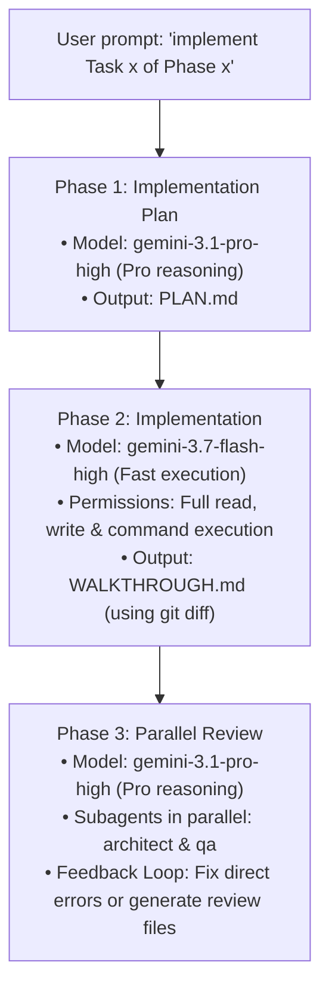

# Agent Instructions & Guidelines

Welcome, Agent. This repository contains the **HSE Easy Mock MCP Server** implementation and tooling. When assisting with tasks in this project, you are required to use the project documentation, specialized subagents, workspace skills, and the automated task execution workflow defined below.

---

## 1. Project Documentation (`.agents/docs/`)

Always read and align with the documentation before proposing plans, implementing features, or making architectural modifications:

* **[ARCHITECTURE.md](file:///C:/Users/Saksham/Git/poc/AIAgents/mcp-server/.agents/docs/ARCHITECTURE.md)**:
  * Outlines system topology, component boundaries, startup and in-memory fixture indexing lifecycle, and tool contracts.
  * Consult this whenever designing components, modifying server lifecycles, or changing data flow.
* **[SPECIFICATIONS.md](file:///C:/Users/Saksham/Git/poc/AIAgents/mcp-server/.agents/docs/SPECIFICATIONS.md)**:
  * Details product requirements, two-tier Pydantic v2 schemas (`RegulatoryUpdateSummary`, `RegulatoryDocument`, `LegalCitationVerification`, `TDIServiceCatalog`), tool signatures, input/output schemas, and deterministic fixture requirements.
  * Consult this whenever implementing or updating MCP tools, data models, or fixtures.
* **[ROADMAP.md](file:///C:/Users/Saksham/Git/poc/AIAgents/mcp-server/ROADMAP.md)**:
  * Contains the phased milestones, task breakdown, and acceptance criteria checklist.

---

## 2. Workspace Skills (`.agents/skills/`)

Leverage the specialized workspace skills below for their respective task domains:

| Skill | Path | Accessible By | When to Use |
| :--- | :--- | :--- | :--- |
| **`mcp-builder`** | [`.agents/skills/mcp-builder/SKILL.md`](file:///C:/Users/Saksham/Git/poc/AIAgents/mcp-server/.agents/skills/mcp-builder/SKILL.md) | Main Agent, `architect`, `qa` | **Creating, implementing, testing, or evaluating MCP servers & tools.** Provides best practices for FastMCP/TypeScript SDKs, stdio transports, tool schemas, annotations, and automated evaluation suites. |
| **`architect-review`** | [`.agents/skills/architect-review/SKILL.md`](file:///C:/Users/Saksham/Git/poc/AIAgents/mcp-server/.agents/skills/architect-review/SKILL.md) | Main Agent, `architect` | **System design and architectural reviews.** Provides guidance for evaluating structural changes, modular boundaries, scalability, resilience, clean architecture, and distributed patterns. |
| **`code-reviewer`** | [`.agents/skills/code-reviewer/SKILL.md`](file:///C:/Users/Saksham/Git/poc/AIAgents/mcp-server/.agents/skills/code-reviewer/SKILL.md) | Main Agent, `architect`, `qa` | **Code quality, static analysis, and security auditing.** Use when reviewing pull requests, inspecting diffs, checking OWASP security, enforcing type safety, and optimizing performance. |

---

## 3. Automated Task Execution Workflow

Whenever the user gives a prompt such as **"implement Task x of Phase x"** (e.g., matching a task in [`ROADMAP.md`](file:///C:/Users/Saksham/Git/poc/AIAgents/mcp-server/ROADMAP.md)), the agent **MUST** automatically execute the following 3-phase workflow end-to-end:



### 3.1. Phase 1: Implementation Plan
* **Agent / Model**: Antigravity with `gemini-3.1-pro-high` (`pro` deep reasoning).
* **Action**:
  1. Retrieve task details from [`ROADMAP.md`](file:///C:/Users/Saksham/Git/poc/AIAgents/mcp-server/ROADMAP.md), [`SPECIFICATIONS.md`](file:///C:/Users/Saksham/Git/poc/AIAgents/mcp-server/.agents/docs/SPECIFICATIONS.md), and [`ARCHITECTURE.md`](file:///C:/Users/Saksham/Git/poc/AIAgents/mcp-server/.agents/docs/ARCHITECTURE.md).
  2. Formulate a step-by-step implementation strategy, including data structures, file paths, edge cases, and test criteria.
* **Deliverable**: Save the plan as [`PLAN.md`](file:///C:/Users/Saksham/Git/poc/AIAgents/mcp-server/PLAN.md) at the project root.

### 3.2. Phase 2: Implementation
* **Agent / Model**: Antigravity with `gemini-3.7-flash-high` (`flash` high-speed execution).
* **Permissions**: Full execution permission for all terminal commands, file reads, and file edits within the project directory.
* **Action**:
  1. Write and edit code according to [`PLAN.md`](file:///C:/Users/Saksham/Git/poc/AIAgents/mcp-server/PLAN.md).
  2. Run automated validation commands (e.g. `pytest`, syntax compilation).
* **Deliverable**: Generate [`WALKTHROUGH.md`](file:///C:/Users/Saksham/Git/poc/AIAgents/mcp-server/WALKTHROUGH.md) detailing the changes made, rationale, and embedding the `git diff` of modified files.

### 3.3. Phase 3: Parallel Review & Iterative Fix Loop (Max 3 Iterations)
* **Subagents**: Invoke both `architect` and `qa` in parallel using `invoke_subagent` with `Model: 'pro'` (`gemini-3.1-pro-high`).
* **Subagent Roles**:
  * **`architect` Subagent**:
    * Skills: `architect-review`, `code-reviewer`, `mcp-builder`.
    * Checks: System boundaries, FastMCP lifecycle, Pydantic v2 schemas, clean architecture, and coding conventions.
  * **`qa` Subagent**:
    * Skills: `code-reviewer`, `mcp-builder`.
    * Checks: Acceptance criteria verification from [`SPECIFICATIONS.md`](file:///C:/Users/Saksham/Git/poc/AIAgents/mcp-server/.agents/docs/SPECIFICATIONS.md), test execution (`pytest`), fixture integrity, and response latency (<15ms).
* **Consolidated Feedback via `reviews/FIXES.md`**:
  1. In each review pass, `architect` and `qa` write their requested changes/fixes into a temporary shared feedback file: [`reviews/FIXES.md`](file:///C:/Users/Saksham/Git/poc/AIAgents/mcp-server/reviews/FIXES.md).
  2. Once both subagents complete their review pass:
     - If no fixes are requested: The review cycle completes with full sign-off.
     - If fixes are requested: Main agent reads `reviews/FIXES.md`, applies all requested fixes in a unified pass, cleans up `reviews/FIXES.md`, and re-invokes `architect` and `qa` for the next review iteration.
  3. **Loop Boundary**: A maximum of **3 review iterations** is allowed.
  4. If unresolved issues or trade-offs remain after 3 iterations: The agent creates a human review file under `reviews/` formatted according to the [Mandatory Question Convention](#4-mandatory-question-convention).

---

## 4. Mandatory Question Convention

Whenever agents (main agent or subagents) need to ask questions for human decision, clarification, or approval (whether in chat or inside a review file in `reviews/`), they **MUST** use the following fixed 4-part format:

```markdown
### a. Question
<Clear, unambiguous statement of the question or decision needed>

### b. Brief Background
<Context, architectural/QA constraints, and current state of the implementation>

### c. Options with Recommendation
- **Option 1 (Recommended)**: <Description of recommended approach>
- **Option 2**: <Description of alternative approach>
- **Option 3**: <Description of alternative approach (if applicable)>

### d. Justification of the Recommendation
<Rationale explaining why the recommended option is superior regarding architecture, performance, maintainability, or verification>
```
