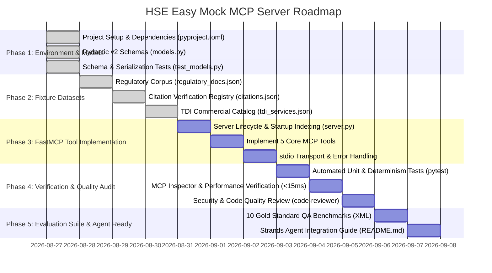

# HSE Easy Mock MCP Server — Implementation Roadmap

This roadmap outlines the phased development, testing, verification, and evaluation plan for the **HSE Easy Mock MCP Server**, aligned with [AGENTS.md](file:///C:/Users/Saksham/Git/poc/AIAgents/mcp-server/AGENTS.md), [ARCHITECTURE.md](file:///C:/Users/Saksham/Git/poc/AIAgents/mcp-server/.agents/docs/ARCHITECTURE.md), and [SPECIFICATIONS.md](file:///C:/Users/Saksham/Git/poc/AIAgents/mcp-server/.agents/docs/SPECIFICATIONS.md).

---

## 🧭 Milestone Overview

---

## 📍 Phase 1: Environment Setup & Data Contracts

* **Relevant Skills**: [`mcp-builder`](file:///C:/Users/Saksham/Git/poc/AIAgents/mcp-server/.agents/skills/mcp-builder/SKILL.md)
* **Goal**: Establish a reproducible Python 3.10+ runtime and define two-tier Pydantic v2 schemas.

### Tasks
- [x] **1.1. Package Management Configuration (`pyproject.toml`)**
  - Configure `uv` / `pip` environment with `fastmcp>=0.1.0`, `pydantic>=2.0.0`, `pytest`, `pytest-asyncio`.
  - Set entrypoint for MCP stdio execution (`python server.py`).
- [x] **1.2. Two-Tier Data Schemas (`models.py`)**
  - Implement **Tier 1**: [`RegulatoryUpdateSummary`](file:///C:/Users/Saksham/Git/poc/AIAgents/mcp-server/.agents/docs/SPECIFICATIONS.md#L30-L64) (lightweight feed metadata for Scout Agent triage).
  - Implement **Tier 2**: [`RegulatoryDocument`](file:///C:/Users/Saksham/Git/poc/AIAgents/mcp-server/.agents/docs/SPECIFICATIONS.md#L67-L86) (deep legal obligations, penalties, sanctions, full markdown text).
  - Implement **Legal QA**: [`CitationVerificationResult`](file:///C:/Users/Saksham/Git/poc/AIAgents/mcp-server/.agents/docs/SPECIFICATIONS.md#L89-L117) (status, canonical references, official portal links).
  - Implement **Commercial Conversion**: [`TDIServiceOffering`](file:///C:/Users/Saksham/Git/poc/AIAgents/mcp-server/.agents/docs/SPECIFICATIONS.md#L120-L144) (topic matching, CTA headlines, body copy, booking URLs).
- [x] **1.3. Schema Validation & Serialization Tests**
  - Write test assertions verifying field constraints, optional fields, literal enums, and JSON serialization.

---

## 📍 Phase 2: Deterministic Mock Fixture Engine

* **Relevant Docs**: [SPECIFICATIONS.md § 5](file:///C:/Users/Saksham/Git/poc/AIAgents/mcp-server/.agents/docs/SPECIFICATIONS.md#L225-L274)
* **Goal**: Author 100% deterministic seed datasets in `fixtures/` with zero external cloud or database dependencies.

### Tasks
- [x] **2.1. Regulatory Corpus (`fixtures/regulatory_docs.json`)**
  - Seed **5 comprehensive HSE legal scenarios**:
    1. `eurlex-dir-2024-869` (EUR-Lex: Lead & Diisocyanates biological limits).
    2. `eurlex-reg-2023-1230` (EUR-Lex: Machinery Regulation & AI safety).
    3. `gu-2024-dl-preposti` (Gazzetta Ufficiale: Preposti appointment & refresher training).
    4. `gu-2023-dm-antincendio` (Gazzetta Ufficiale: High-risk plant fire safety & certification).
    5. `inail-2024-circ-calore` (INAIL: Heat stress protocol in construction & agriculture).
- [x] **2.2. Legal Citations Registry (`fixtures/citations.json`)**
  - Populate active/valid citations: `D.Lgs. 81/2008 Art. 37`, `D.Lgs. 81/2008 Art. 18`, `Direttiva 2004/37/CE`, `Regolamento (UE) 2023/1230 Art. 10`, `Circolare INAIL 28/2024`.
  - Populate invalid/repealed test citations: `D.P.R. 547/55 Art. 10`, `D.Lgs. 626/94 Art. 3`, `Direttiva 98/37/CE`.
  - Include multi-alias normalization index (case-insensitivity, spacing variations).
- [x] **2.3. Commercial Services & CTAs (`fixtures/tdi_services.json`)**
  - Seed 4 TDI commercial offerings with conversion-oriented copy:
    1. `tdi-srv-preposti-training` (Preposti training & updates).
    2. `tdi-srv-chemical-audit` (Chemical & CMRD substances audit).
    3. `tdi-srv-machinery-ce` (Machinery CE marking & compliance).
    4. `tdi-srv-heat-stress` (Microclimate & thermal stress evaluation).

---

## 📍 Phase 3: FastMCP Server & Tool Implementation

* **Relevant Skills**: [`mcp-builder`](file:///C:/Users/Saksham/Git/poc/AIAgents/mcp-server/.agents/skills/mcp-builder/SKILL.md), [`architect-review`](file:///C:/Users/Saksham/Git/poc/AIAgents/mcp-server/.agents/skills/architect-review/SKILL.md)
* **Goal**: Implement in-memory indexing, error handling, and the 5 MCP tools in `server.py`.

### Tasks
- [x] **3.1. In-Memory Indexing & Fast Startup (`server.py`)**
  - Implement startup loader that validates all fixtures with Pydantic models on initialization (<50ms startup).
  - Construct in-memory hash maps and search indexes for instant lookup.
- [ ] **3.2. Implement the 5 Core Tools**
  - [ ] `list_regulatory_updates`: Date range filtering (`date_from`, `date_to`), source filtering, stable publication date descending sort.
  - [ ] `search_regulatory_docs`: Keyword, source, and topic-based discovery returning Tier 1 summaries.
  - [ ] `get_document_by_id`: Exact lookup returning complete Tier 2 `RegulatoryDocument`; raise clear `ValueError` on 404.
  - [ ] `verify_legal_citation`: Normalized lookup against citation registry returning canonical citation, validity boolean, status, and official portal URL.
  - [ ] `get_tdi_service_offerings`: Topic and sector matching with a deterministic fallback offering.
- [x] **3.3. Tool Docstrings & JSON Schema Annotations**
  - Ensure every tool has rich docstrings, parameter descriptions, and type annotations for LLM discoverability.

---

## 📍 Phase 4: Verification, Quality Assurance & Security Audit

* **Relevant Skills**: [`code-reviewer`](file:///C:/Users/Saksham/Git/poc/AIAgents/mcp-server/.agents/skills/code-reviewer/SKILL.md)
* **Goal**: Enforce deterministic latency (<15ms), schema correctness, and production-grade code quality.

### Tasks
- [ ] **4.1. Automated Test Suite (`tests/test_server.py`)**
  - Test date-window filtering and ordering in `list_regulatory_updates`.
  - Test keyword matching and source isolation in `search_regulatory_docs`.
  - Test exact doc retrieval and exception handling in `get_document_by_id`.
  - Test legal validation test cases: `verify_legal_citation("D.Lgs. 81/2008 Art. 37")` $\rightarrow$ `is_valid: true`, `verify_legal_citation("D.Lgs. 626/94 Art. 3")` $\rightarrow$ `is_valid: false` (repealed).
  - Test commercial CTA matching: `get_tdi_service_offerings("chemical_risk")` $\rightarrow$ `tdi-srv-chemical-audit`.
- [ ] **4.2. MCP Inspector Interactive Validation**
  - Test interactive tool invocation via `uv run fastmcp dev server.py`.
  - Verify zero console noise on `stdio` (all logs redirected to `stderr`).
- [ ] **4.3. Code Quality & Security Audit**
  - Run static analysis with `code-reviewer` guidelines (strict typing, input sanitization, error resilience).

---

## 📍 Phase 5: Agent Benchmark Evaluation Suite & Integration

* **Relevant Skills**: [`mcp-builder/reference/evaluation.md`](file:///C:/Users/Saksham/Git/poc/AIAgents/mcp-server/.agents/skills/mcp-builder/reference/evaluation.md)
* **Goal**: Deliver a 10-question evaluation benchmark XML and integration documentation for Strands agents.

### Tasks
- [ ] **5.1. Construct 10 Gold-Standard QA Evaluation Pairs (`evaluations/hse_eval.xml`)**
  - Craft 10 complex, deterministic, read-only questions across all 5 mock documents and citation tables.
  - Verify every single QA pair using automated evaluation scripts in [`.agents/skills/mcp-builder/scripts/evaluation.py`](file:///C:/Users/Saksham/Git/poc/AIAgents/mcp-server/.agents/skills/mcp-builder/scripts/evaluation.py).
- [ ] **5.2. Integration Guide & README (`README.md`)**
  - Document client configuration for Strands Agent SDK, AWS Bedrock AgentCore, Claude Desktop, and Antigravity.
  - Provide sample agent loop commands and JSON-RPC over stdio setup.

---

## 🏁 Acceptance Criteria Checklist

| Requirement | Target | Verification Method |
| :--- | :--- | :--- |
| **Startup Time** | $<50\text{ ms}$ | In-memory indexing benchmark |
| **Response Latency** | $<15\text{ ms}$ per tool call | `pytest-benchmark` / stdio timing |
| **Protocol Compliance** | Model Context Protocol (MCP) | FastMCP Inspector (`fastmcp dev`) |
| **Schema Strictness** | Pydantic v2 validation | Two-tier model validation tests |
| **External Dependencies** | 0 cloud / 0 database | Standalone local execution |
| **Evaluation Suite** | 10/10 reproducible QA pairs | `evaluation.py` benchmark run |
